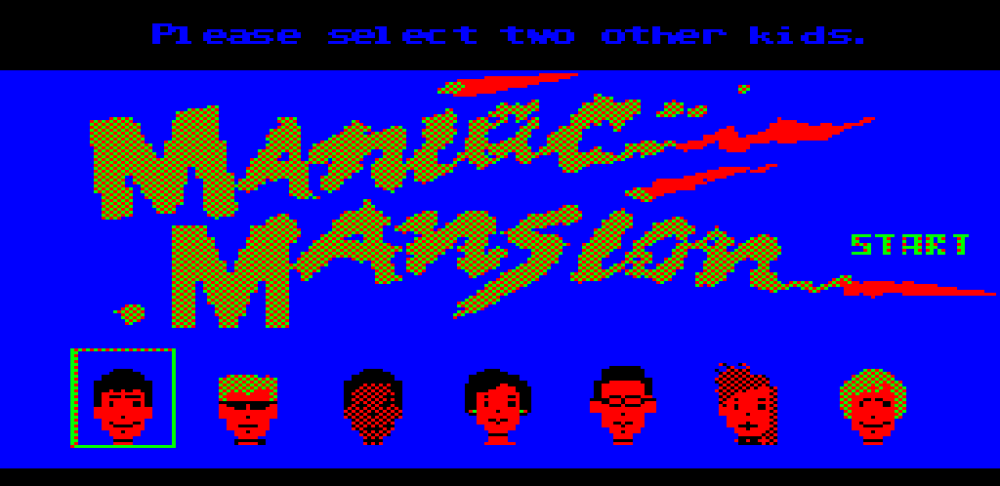

# Порт Maniac Mansion (SCUMM v1) для компьютера Электроника БК-0010

**Maniac Mansion** (Lucasfilm Games, 1987) — комедийный приключенческий квест «укажи и
щёлкни», первая игра на движке SCUMM. Безумный доктор Фред, подчинённый упавшему
метеориту, похитил подругу Дэйва — Сэнди. Дэйв и двое друзей, которых игрок выбирает из
шести, пробираются в особняк семейства Эдисонов, чтобы её спасти. У каждого героя свои
умения, поэтому от выбора команды зависят пути прохождения и концовки. Игрок составляет
действия из глаголов внизу экрана и предметов: «Open door», «Pick up key».



Перевод на Си интерпретатора SCUMM v1 (Maniac Mansion для DOS, 1988) для БК-0010 с блоком
расширения памяти СМК-512.

Игра идёт и на БК-0010-01, и на БК-0011М (тоже с СМК-512, под ANDOS). Модель определяется
при запуске. На БК-0011М процессор и таймер ВИ1 быстрее (31250 Гц вместо 23437.5): игра
там идёт в 4/3 быстрее (20 шагов в секунду вместо 15), а высота и длительность звуков
пересчитываются под таймер и звучат как в оригинале.

## Управление

Курсор водится клавишами, джойстиком или мышью «Марсианка» (УВК-01): она подключается к
тому же параллельному порту и работает как джойстик.

| Клавиша | Действие |
|---|---|
| ← → ↑ ↓ | курсор (пока клавиша нажата — повторяется) |
| ВВОД | щелчок: выбрать глагол, предмет, место |
| КТ | пропустить заставку (ESC) |
| СБР | меню записи и загрузки: **1**–**3** — записать игру, **4**–**6** — загрузить |

Глаголы — буквенными клавишами БК (раскладка ЙЦУКЕН; ЛАТ/РУС и ЗАГЛ/СТР не важны),
по местам глаголов на экране:

| | | | | |
|---|---|---|---|---|
| **Й** (J) Push | **Ц** (C) Open | **У** (U) Walk to | **К** (K) Unlock | **Е** (E) Turn on |
| **Ф** (F) Pull | **Ы** (Y) Close | **В** (W) Pick up | **А** (A) New kid | **П** (P) Turn off |
| **Я** (Q) Give | **Ч** (^) Read | **С** (S) What is | **М** (M) Use | **И** (I) Fix |

Инвентарь: **Ш**, **Щ** — верхние предметы (левый, правый), **Л**, **Д** — нижние;
**Г**, **О** — листать вверх и вниз.

> 💡 **Лайфхак для эмулятора на ПК.** Включите на ПК русскую раскладку: тогда клавиши
> ПК передают в эмулятор буквы ЙЦУКЕН, и глаголы оказываются под пальцами на тех же местах,
> что на экране и в оригинальной игре — **Q W E R T / A S D F G / Z X C V B** ПК
> (Й Ц У К Е / Ф Ы В А П / Я Ч С М И), инвентарь — **I O / K L**, листание — **U / J**.
> Работает в эмуляторах, которые переводят нажатия в символы, а не в места клавиш.

Джойстик на параллельном порту (раскладка «Стандарт»): ручка — курсор (с разгоном),
кнопки A/X — щелчок, B/Y и Start — пропуск заставки (как КТ).
Мышь «Марсианка»: перемещение — курсор, кнопки — щелчок.

Записи хранятся в файлах MMSAVE1..MMSAVE3 на дискете; запись другой сборки игры не
загружается (ERROR 4).

## Инструкция по сборке кросс-компилятора **gcc** для процессора **КР1801ВМ1** под ОС Linux

Для настройки кросс-компилятора gcc для процессора **КР1801ВМ1** понадобятся свежие исходники компилятора gcc,
которые можно взять с **ftp.gnu.org** из папки [gcc](https://ftp.gnu.org/gnu/gcc/) и свежие исходники *binutils*,
которые можно найти в папке [binutils](https://ftp.gnu.org/gnu/binutils/)

На момент написания это были версии **gcc-14.2.0** и **binutils-2.43**.

Сначала, создаём папку, в которую будем скачивать компилятор и *binutils* и заходим в эту папку:
```
mkdir -p gcc-KP1801BM1/src
cd gcc-KP1801BM1/src
```
Скачиваем в эту папку архивы с исходниками *gcc* и *binutils*, например так:
```
wget https://ftp.gnu.org/gnu/gcc/gcc-14.2.0/gcc-14.2.0.tar.gz
wget https://ftp.gnu.org/gnu/binutils/binutils-2.43.tar.gz
```

Распаковываем архивы с *gcc* и *binutils*:
```
tar -xvzf gcc-14.2.0.tar.gz
tar -xvzf binutils-2.43.tar.gz
```

Заходим в папку *gcc-14.2.0* и запускаем скрипт *./contrib/download_prerequisites*
```
cd gcc-14.2.0
./contrib/download_prerequisites
```

Применяем патч **gcc-KP1801BM1.patch** из папки проекта для получения возможности использования компилятором команд процессора **sob и xor**, которые присутствуют в процессоре **КР1801ВМ1**, но отсутствуют в **DEC PDP-11/10**:
```
patch -p1 < ~/БК0010-develop/maniac-v1-bk0010/gcc-KP1801BM1.patch
```

Затем заходим в папку *binutils-2.43* и так же применяем патч ассемблера **binutils-KP1801BM1.patch** из папки проекта: без него слишком дальний переход **br**/**bxx**/**sob** собирается без ошибки, но уходит не туда:
```
cd ../binutils-2.43
patch -p1 < ~/БК0010-develop/maniac-v1-bk0010/binutils-KP1801BM1.patch
```

Выходим снова в папку *gcc-KP1801BM1* и создаём там папку *build*, входим в неё и создаём папки для сборки компилятора и *binutils*:
```
cd ../..
mkdir build
cd build
mkdir gcc
mkdir binutils
```

Заходим в папку **binutils** и конфигурируем *binutils*:
```
cd binutils
../../src/binutils-2.43/configure --prefix $HOME/xgcc --bindir $HOME/bin --target pdp11-aout
```

В этой команде после параметра **--prefix** указан путь на папку с файлами кросс-компилятора, где будут находиться папки *include*, *lib* и т.д. кросскомпилятора.
В данном случае папка кросс компилятора будет расположена в домашней директории в папке *xgcc*.

После параметра **--bindir** указан путь куда будут помещены исполняемые файлы кросс-компилятора.
В данном случае использована папка *bin* в домашней папке пользователя.

Далее, собираем *binutils* и, затем, устанавливаем его по пути, указанном в предыдущей команде:
```
make -j7
make install
```

Параметр **-j7** после make указывает на то, что для сборки будут использованы семь ядер компьютера.
Имеет смысл указывать количество, на одно ядро меньшее, чем присутствует в компьютере - для избежания зависаний ОС во время сборки.

Далее, выходим из этой папки, и таким же образом конфигурируем *gcc* войдя в папку **gcc**:
```
cd ../gcc
../../src/gcc-14.2.0/configure --prefix $HOME/xgcc --bindir $HOME/bin --target pdp11-aout --enable-languages=c --with-gnu-as --with-gnu-ld --without-headers --disable-libssp
```

Затем, собираем *gcc* и устанавливаем его:
```
make -j7
make install
```

В результате этого процесса, после инсталляции, в папке **bin** *домашней папки* должны появится запускаемые файл компилятора, такие как **pdp11-aout-gcc**, **pdp11-aout-as**, а в папке **xgcc** (тоже в домашней папке) должны появится папки **include**, **lib**, **pdp11-aout** и др.

Файл **stdint.h** с 8-ми, 16-ти и 32-битными целыми типами лежит в папке проекта и подключается
ключом `-I.` раньше `$(XGCC)/include`, поэтому класть его в **xgcc/include** не нужно.
