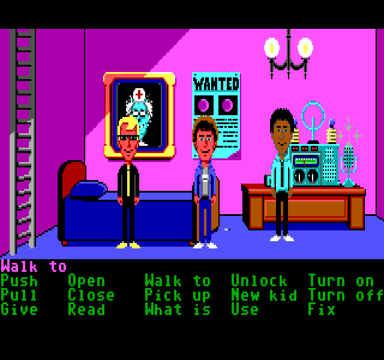

# Порт Maniac Mansion (SCUMM v2) для компьютера Электроника БК-0011М

**Maniac Mansion** (Lucasfilm Games, 1987) — комедийный квест «укажи и щёлкни», первая
игра на движке SCUMM. Это перевод на Си интерпретатора SCUMM v2 (по ScummVM) для улучшенной
версии игры (Maniac Mansion Enhanced для DOS, графика EGA).

Картинку игра выводит на экран БК-0011М (палитры и узоры 2x2), а с контроллером **AZБК** —
на его VGA: 16 цветов EGA точка в точку, как в DOS-версии (подробности — в разделе
«Что даёт AZБК»). Снимок VGA в эмуляторе bk0010-emulator:



## Что нужно

- **БК-0011М** (4 МГц) с контроллером **СМК-512** под ANDOS. СМК работает в режиме All:
  на настоящей машине нужна доработка **Б6** (ПЗУ БОС отключается сигналом с разъёма МПИ).
- Музыкальный сопроцессор **AY-3-8910** на порту 0177714 (как у «Мультизвука», такт 1,71 МГц).
- Мышь «Марсианка» (УВК-01) или джойстик на параллельном порту — по желанию.
- Контроллер **AZБК** — по желанию: игра находит его сама и рисует на его VGA (ниже). В
  Setup платы должна быть включена эмуляция СМК-512 (SMK-512 Emulation).

На БК-0010 игра не запускается (сообщение NEED BK-0011M), без СМК — тоже (NEED SMK-512).
Электронный диск E: ANDOS игра
портит: она берёт свободные страницы ОЗУ 11М под звук и буфер загрузки.

## Что даёт БК-0011М

- **Звук на AY**: партии PCjr/Tandy оригинала — три голоса и шум (или, пунктом меню, поток
  PC-спикера на одном канале). Плеер Player_V2 работает в кадровом прерывании, в отдельной
  странице ОЗУ 11М; по тактам он совпадает с ScummVM (tools/v2snd.py, tools/scene.py drvcheck).
- **Палитры**: у каждой комнаты своя из 16 палитр БК-0011М (tools/pal11.py подбирает её и
  узоры 2x2 для 16 цветов EGA); палитра меняется вместе с кадром.
- **Две экранные страницы**: прокрутка и смена комнаты рисуются в скрытой странице и
  показываются целиком; при чтении файлов экран не портится.
- **Кадровое прерывание**: время игры — точно 60 Гц, курсор от джойстика и мыши — в каждом
  кадре (~49 Гц).

## Что даёт AZБК

Игра проверяет плату при пуске (версия ПЛИС 0177370 и окно маппера) и, если нашла, грузит
модуль AZMOD в страницу 6 ОЗУ 11М и рисует на VGA платы; экран самой БК показывает
только «AZBK: VGA».

- **16 цветов EGA без сжатия**: 512x256 точек (VGA 1024x768), картинка игры 320x200 — по
  центру, точка в точку, цвета — как в DOS-версии, без узоров.
- **Три слоя** (режим 0177230 = 076136): курсор, интерфейс, комната с актёрами; цвет 0
  верхних слоёв прозрачен.
- **Аппаратная прокрутка**: широкая комната лежит в слое целиком (строка — 1024 точки),
  сдвиг камеры — регистр прокрутки, в гашении кадра; блиттер переносит только вошедшую в
  вид полосу фона и гасит ушедшую.
- **Блиттер**: полосы фона из «склада» в памяти AZ, очистка, курсор, холсты актёров (фон
  под ними — из склада, актёры — процессором поверх, затем в слой). Конечности актёров —
  спрайтами из кэша в памяти AZ (32 Мбайт хватает с запасом).

Слои по 128 Кбайт и склад фона лежат выше первого мегабайта памяти AZ. Режим с тремя
слоями проверен в эмуляторе (по GID и retro-tang-bk); на плате автор тестера AZVIDT
проверял только однослойные режимы.

## Управление

| Клавиша | Действие |
|---|---|
| ← → ↑ ↓ | курсор (пока клавиша нажата — повторяется) |
| ВВОД | щелчок: выбрать глагол, предмет, место |
| КТ | пропустить заставку (ESC); после конца игры — играть заново |
| 1, 2, 3 | сменить героя (в DOS-версии — F1, F2, F3) |
| СБР | меню: **1**, **2** — записать игру, **3**, **4** — загрузить, **7** — звук PCjr / PC-спикер |

Глаголы — буквенными клавишами по местам на экране (раскладка ЙЦУКЕН; ЛАТ/РУС и ЗАГЛ/СТР
не важны): **Й Ц У К Е / Ф Ы В А П / Я Ч С М И**. Инвентарь: **Ш**, **Щ** — верхние
предметы, **Л**, **Д** — нижние; **Г**, **О** — листать вверх и вниз.

Джойстик (раскладка «Стандарт»): ручка — курсор (с разгоном), A/X — щелчок, B/Y и Start —
пропуск заставки. Мышь «Марсианка»: перемещение — курсор, кнопки — щелчок и пропуск.

Записи хранятся в файлах MMSAVE1, MMSAVE2 на дискете. При неудаче в строке меню —
`ERROR к ддд` до нажатия клавиши: к = 1 — запись не помещается в файл, 2 — ошибка
записи, 3 — ошибка чтения, 4 — запись другой сборки игры (не загружается); ддд —
ответ драйвера дисковода в ПЗУ (восьмерично; 007 — прерывание по вектору 4 во время
обмена).

## Известные проблемы

- На БК-0011М с **Gryphon MPI** запись игры (СБР, 1/2) перезапускает игру. С АЗБК и в
  эмуляторе запись работает; причина пока не найдена.

## Сборка и запуск

`make` собирает образ дискеты `bin/MANIAC_<версия>.IMG` (ANDOS с автозапуском игры);
`make run` — в эмуляторе bk0010-emulator (БК-0011М, СМК-512, AY, дискета с записью).
Нужны:

- кросс-компилятор pdp11-aout (см. ниже) в `$(XGCC)` — по умолчанию `/home/prcoder/xgcc`,
  другой путь: `make XGCC=...`;
- python3 и gcc для хоста (сборка упаковщика tools/salvador);
- файлы игры 00.LFL..53.LFL (Maniac Mansion Enhanced, DOS) в каталоге проекта;
- исходники ScummVM в /home/prcoder/scummvm (таблицы опкодов и шрифт; путь задан в Makefile);
- для `make run` — эмулятор в `$(EMU)` (по умолчанию
  `~/claude-experiments/bk0010-emulator/build/bk0010-emulator`).

На дискету файлы LFL идут сжатыми ZX0 (tools/salvador, tools/zx0lfl.py; 57% исходного,
на дискете свободно ~110 кластеров по 2 Кбайт); распаковывает их загрузчик (zx0.s).

Для разработки:

| Команда | Что делает |
|---|---|
| `make shot` | прогон в эмуляторе без окна на `FRAMES` кадров (клавиши — `KEYS`), снимок в run.png |
| `BK_AZ=1 tools/scene.py ...` | сцены с AZБК: дискета — диск AZ0, загрузка — BIOS платы, снимок — VGA |
| `make g-mpi` | образ — на Gryphon MPI по сети и запуск |
| `make sizes` | размеры ядра, общей копии, банков и драйвера звука |
| `make clean; make TIMING=1` | замеры частей шага игрового цикла |
| `make clean; make LIMB_C=1` | конечности актёров — моделью на Си вместо limb.s (сверка) |
| `make -C test` | тесты на хосте: ресурсы, графика, полосы фона |

Замеры скорости — docs/perf.md.

Ядро — в базовом ОЗУ, общая копия кода — во всех страницах СМК, банки кода A..D — в своих
страницах. Известные ошибки тулчейна и их обходы — в [TOOLCHAIN-BUGS.md](TOOLCHAIN-BUGS.md).

## Инструкция по сборке кросс-компилятора **gcc** для процессора **КР1801ВМ1** под ОС Linux

Для настройки кросс-компилятора gcc для процессора **КР1801ВМ1** понадобятся свежие исходники компилятора gcc,
которые можно взять с **ftp.gnu.org** из папки [gcc](https://ftp.gnu.org/gnu/gcc/) и свежие исходники *binutils*,
которые можно найти в папке [binutils](https://ftp.gnu.org/gnu/binutils/)

На момент написания это были версии **gcc-14.2.0** и **binutils-2.43**.

Сначала, создаём папку, в которую будем скачивать компилятор и *binutils* и заходим в эту папку:
```
mkdir -p gcc-KP1801BM1/src
cd gcc-KP1801BM1/src
```
Скачиваем в эту папку архивы с исходниками *gcc* и *binutils*, например так:
```
wget https://ftp.gnu.org/gnu/gcc/gcc-14.2.0/gcc-14.2.0.tar.gz
wget https://ftp.gnu.org/gnu/binutils/binutils-2.43.tar.gz
```

Распаковываем архивы с *gcc* и *binutils*:
```
tar -xvzf gcc-14.2.0.tar.gz
tar -xvzf binutils-2.43.tar.gz
```

Заходим в папку *gcc-14.2.0* и запускаем скрипт *./contrib/download_prerequisites*
```
cd gcc-14.2.0
./contrib/download_prerequisites
```

Применяем патч **gcc-KP1801BM1.patch** из папки проекта. Он добавляет ключ **-m1801vm1** — команды **sob и xor**, которые есть в процессоре **КР1801ВМ1**, но отсутствуют в **DEC PDP-11/10** (ставится после `-m10`: `-m10` его сбрасывает), — и исправляет ошибки gcc 14.2 для pdp11: bool из сравнений, сравнения и деление 32-битных чисел, потерю регистров при reload, побайтную запись в регистры устройств через битовые поля. Подробности — в [TOOLCHAIN-BUGS.md](TOOLCHAIN-BUGS.md):
```
patch -p1 < ~/БК0010-develop/maniac-bk0010/gcc-KP1801BM1.patch
```

Затем заходим в папку *binutils-2.43* и так же применяем патч ассемблера **binutils-KP1801BM1.patch** из папки проекта: без него слишком дальний переход **br**/**bxx**/**sob** собирается без ошибки, но уходит не туда:
```
cd ../binutils-2.43
patch -p1 < ~/БК0010-develop/maniac-bk0010/binutils-KP1801BM1.patch
```

Выходим снова в папку *gcc-KP1801BM1* и создаём там папку *build*, входим в неё и создаём папки для сборки компилятора и *binutils*:
```
cd ../..
mkdir build
cd build
mkdir gcc
mkdir binutils
```

Заходим в папку **binutils** и конфигурируем *binutils*:
```
cd binutils
../../src/binutils-2.43/configure --prefix $HOME/xgcc --bindir $HOME/bin --target pdp11-aout
```

В этой команде после параметра **--prefix** указан путь на папку с файлами кросс-компилятора, где будут находиться папки *include*, *lib* и т.д. кросскомпилятора.
В данном случае папка кросс компилятора будет расположена в домашней директории в папке *xgcc*.

После параметра **--bindir** указан путь куда будут помещены исполняемые файлы кросс-компилятора.
В данном случае использована папка *bin* в домашней папке пользователя.

Далее, собираем *binutils* и, затем, устанавливаем его по пути, указанном в предыдущей команде:
```
make -j7
make install
```

Параметр **-j7** после make указывает на то, что для сборки будут использованы семь ядер компьютера.
Имеет смысл указывать количество, на одно ядро меньшее, чем присутствует в компьютере - для избежания зависаний ОС во время сборки.

Далее, выходим из этой папки, и таким же образом конфигурируем *gcc* войдя в папку **gcc**:
```
cd ../gcc
../../src/gcc-14.2.0/configure --prefix $HOME/xgcc --bindir $HOME/bin --target pdp11-aout --enable-languages=c --with-gnu-as --with-gnu-ld --without-headers --disable-libssp
```

Затем, собираем *gcc* и устанавливаем его:
```
make -j7
make install
```

В результате этого процесса, после инсталляции, в папке **bin** *домашней папки* должны появится запускаемые файл компилятора, такие как **pdp11-aout-gcc**, **pdp11-aout-as**, а в папке **xgcc** (тоже в домашней папке) должны появится папки **include**, **lib**, **pdp11-aout** и др.

Файл **stdint.h** с 8-ми, 16-ти и 32-битными целыми типами лежит в папке проекта и подключается
ключом `-I.` раньше `$(XGCC)/include`, поэтому класть его в **xgcc/include** не нужно.
